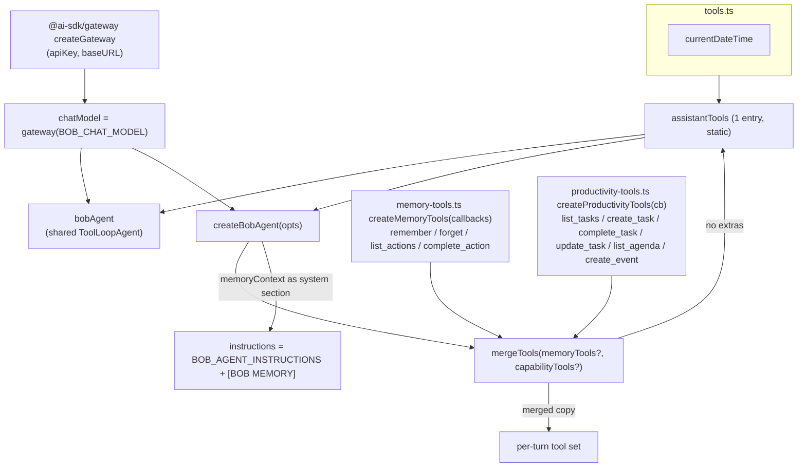
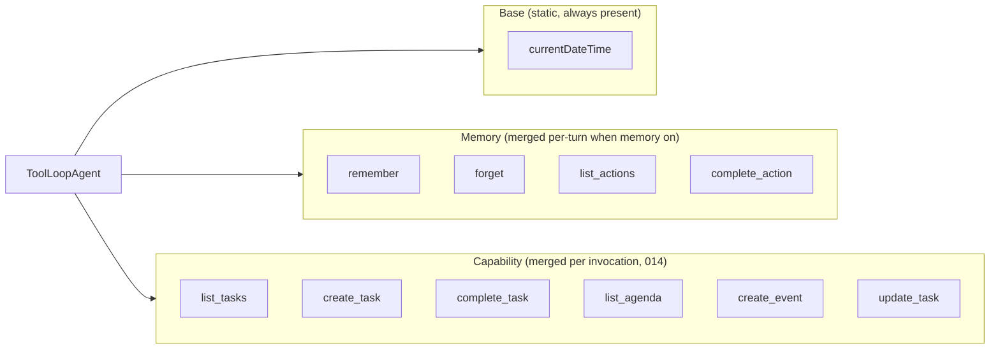
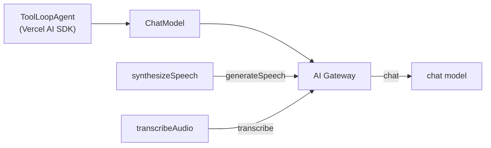

# `@bob/ai` — agent, provider, and tools

The agent layer (`apps/ai/src`). Key facts from the code:

- The **static registry** `assistantTools` has exactly one entry:
  `currentDateTime` (`tools.ts:341`). `textToSpeechTool` and `speechToTextTool`
  are still exported but not offered to the model: the voice pipeline runs
  STT/TTS itself and the model only sees text (#408).
- The **real tool set** is larger and per-turn: `createBobAgent` merges the
  memory tools (`remember`, `forget`, `list_actions`, `complete_action` from
  `memory-tools.ts`) and capability tools (`list_tasks`, `create_task`,
  `complete_task`, `update_task`, `list_agenda`, `create_event` from
  `productivity-tools.ts`) into `assistantTools` — a name clash throws.
- `bobAgent` is the shared singleton over `assistantTools`; `createBobAgent`
  builds a fresh `ToolLoopAgent` per call.

## Agent construction

## Tool groups

## How tools reach the agent

The static `assistantTools` registry is only ever the **base**. On any turn
that needs more:

- **Memory on** (device and web turns in a private space): `createBobAgent` merges
  `createMemoryTools(createMemoryCallbacks(db, userId, …))` into the base set.
  `apps/ai` never imports the DB — the callbacks are implemented by `apps/api`
  (`apps/api/src/memory/callbacks.ts`). Since #756 memory is on only when
  `allowsPersonalMemory(spaceKind)` holds for the turn's conversation
  (`getConversationScope`): a device or web turn in a pair or group space gets
  no memory block, no memory tools and no extraction.
- **Invocation** (014, thread "ask Bob"): `createBobAgent` merges
  `createProductivityTools(cb)` bound to one `CommandContext` (closed over a
  space + actor), so tool input schemas carry no `space_id`/`user_id`. A
  shared-space invocation passes an explicit empty memory-tool set.

The `ToolLoopAgent` therefore runs with **seven to twelve** tools depending on
the turn, never the three in `assistantTools` alone.

## Provider boundary

STT/TTS belong to Core (not any transport) and go through the AI Gateway, per
`architecture.md` "Speech belongs to Core".