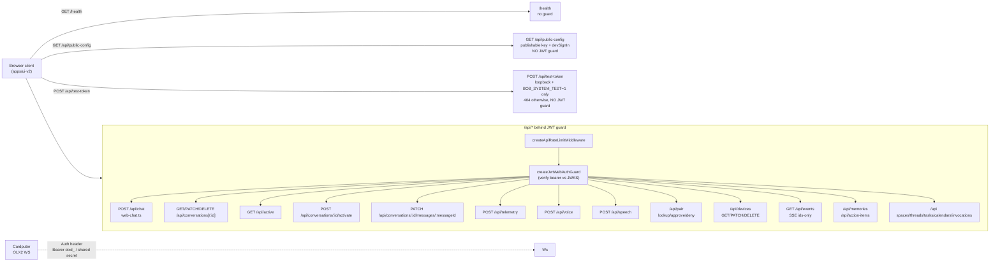
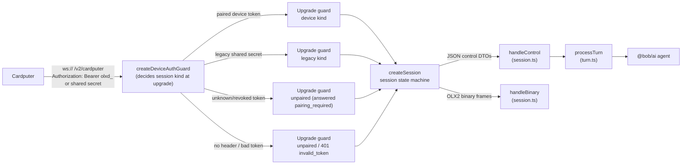
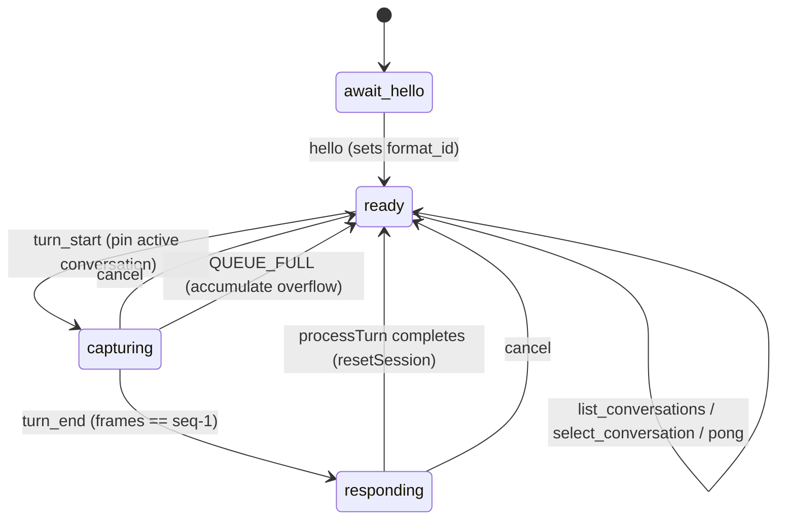
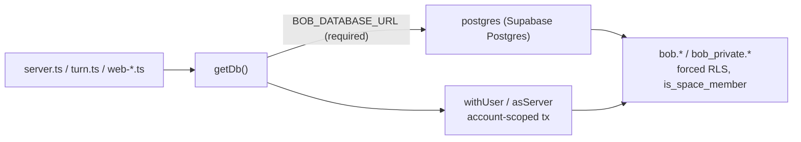

# `@bob/api` — HTTP and WebSocket surface

High-level structure of the API package (`apps/api/src`). The wire contract
itself lives in `schemas.ts`; the turn pipeline in `turn.ts`; the session
state machine in `session.ts`. All names and routes here are taken from the
code, not the prose.

- HTTP server: `server.ts` (WebSocketExpress + Express).
- Device WebSocket: `ws://<host>:7444/v2/cardputer` (`V2_PATH`).
- HTTP REST: `/api/*` behind a Supabase JWT guard.
- Persistence: one `Db` port over `postgres` (Supabase: the local stack in
  development, tests and HIL, hosted in production; `platform/db/db.ts`), all
  account SQL behind `withUser` + row-level security.

## HTTP surface and guards

Notes:

- `GET /api/public-config` and the loopback-only `POST /api/test-token` are
  mounted **before** the guard; every other `/api/*` route sits behind it.
- `requireActiveSession` is an extra check (active Supabase session) applied
  inside `/api/pair/{approve,deny}`, `/api/devices/:id` `DELETE`,
  `/api/memories` `DELETE`, and `POST /api/conversations/:id/activate`.
- The 014 routers (`spaces/threads/tasks/calendars/invocations`) mount at the
  guard root and need no extra check.
- `POST /api/invitations/:token` accept stays authenticated; only the
  account-less preview `GET /api/invitations/:token` is guard-exempt.

## Device WebSocket route

## Session state machine

Stages come from `SessionStageSchema` (`await_hello | ready | capturing |
responding`). Only `hello`, `pair_request`, `pong` are legal for an **unpaired**
session; everything else answers `error { code: UNPAIRED }`.

The pinned active conversation may be a space thread, sent as `thr_<uuid>` (#565). With an active
space, `list_conversations` lists up to 5 of its threads first, then General conversations, 10 rows
at most. `select_conversation` on a thread sets the active space and the pointer in one transaction.
A thread is a conversation in a pair or group space; since #756 it lives in the same
`conversations`/`messages` tables as General. After the reply, `turn/persist.ts` makes one call,
`persistDeviceTurn` (`voice/cardputer-conversation.ts`), which reads the pinned ref's
`getConversationScope` and saves a shared turn (`saveSharedTurn` in `voice/device-thread.ts`)
or a private one by the space kind, never by the ref prefix. See
[device-conversation.md](../design/device-conversation.md) and [data-model.md](data-model.md).

## Store

## Where the AI layer is called

`@bob/api` imports `@bob/ai` (via the `@/ai/*` path alias). Two entry
points drive the agent:

- **Device turns** (`turn.ts:runAgent`): `processTurn` → `generateReply` →
  `runAgent(messages, agent)` where `agent` is the shared `bobAgent`
  singleton, or a per-turn `createBobAgent` when memory is on.
- **Web turns** (`web-chat.ts:webChat`): `createAgentUIStreamResponse` with the
  shared `bobAgent`, or a per-turn `createBobAgent` when memory is on.

Both build the per-turn agent with `createBobAgent({ memoryContext,
memoryTools })` only when memory is available; otherwise they use the static
`bobAgent` singleton unchanged.