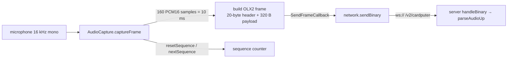
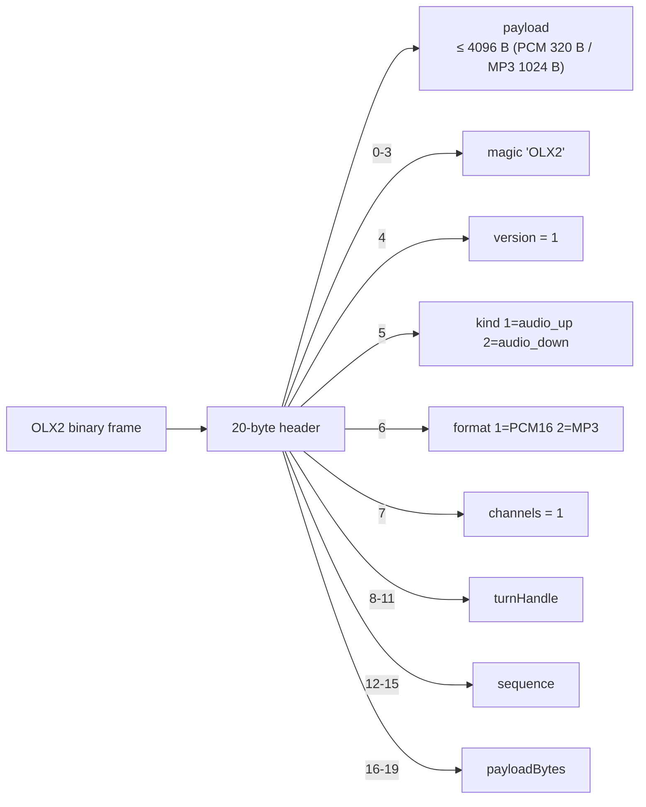
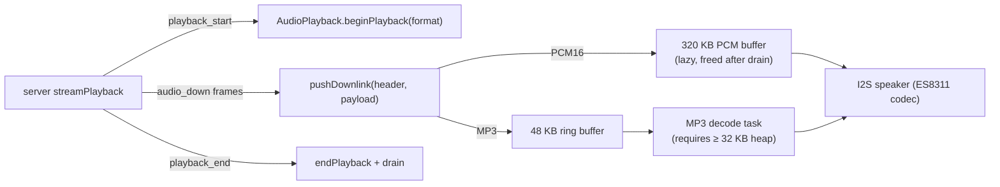
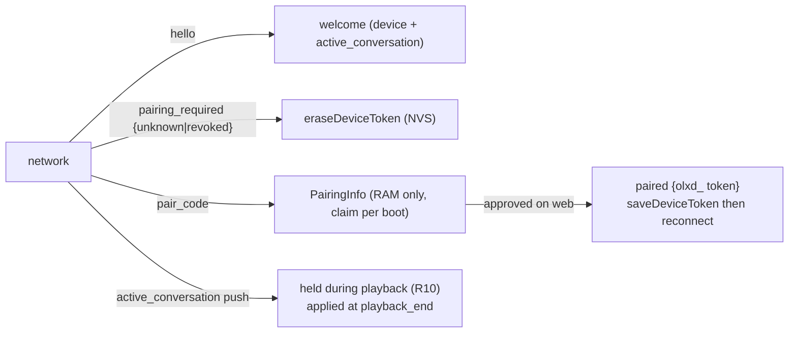

# `@bob/cardputer` — ESP32 firmware

PlatformIO firmware for the M5Stack Cardputer (`apps/cardputer`). Modules:
`state.h` (main loop / state machine), `protocol.h` (control JSON + OLX2
parse), `audio_capture.h` (mic + uplink framing), `audio_playback.h`
(downlink PCM/MP3), `network.h` (Wi-Fi/WebSocket), `device_token.h` (NVS
`olxd_` token). Constants in `config.h`; shared types in `types.h`.

## Main loop and state machine

```mermaid
stateDiagram-v2
    [*] --> kBoot
    kBoot --> kWifi: stateSetup (WiFi.begin, setSleep false)
    kWifi --> kSocket: wifi connected → network.start()
    kSocket --> kReady: welcome (hello accepted, format negotiated)
    kSocket --> kWifi: wifi lost
    kReady --> kCapturing: BtnA held → beginTurn (turn_start)
    kCapturing --> kAwaiting: BtnA released → endTurn (turn_end)
    kAwaiting --> kReady: playback done / status idle
    kReady --> kSelecting: 'c' key (conversation picker)
    kSelecting --> kReady: select / cancel
    kSocket --> kPairing: pairing_required
    kPairing --> kSocket: paired (reconnect with NVS token)
    kReady --> kError: server error / mic failure
    kError --> kSocket: BtnA retry (requestSocketRetry)
    kAwaiting --> kCapturing: (ignored; turns only begin in kReady)
```

The `State` enum and `ServerStage` live in `types.h`. `stateLoop` calls
`network.pollEvents()`, `playback.loop()`, Wi-Fi supervision, PTT/reply
handling, keyboard, and pairing housekeeping each iteration.

## Audio capture (uplink)

`capturePcm_[160]` (10 ms) and `audioFrame_[340]` (header + samples). The
uplink sequence resets at `turn_start`.

## OLX2 frame codec

The 20-byte header, byte layout from `config.h` / `schemas.ts`:

Server builds downlink frames with `serializeAudioFrame`; the device parses
them with `parseOlx2Header` and feeds `AudioPlayback.pushDownlink`.

## Downlink playback

- MP3 is the default downlink format; the device hello advertises it
  (`BOB_PCM16_HELLO` forces PCM16).
- The server paces chunks and the device tracks downlink sequence gaps; a
  missing frame past the stall threshold is journaled as `downlink_stalled`.

## Pairing / follow-me wiring

The NVS `olxd_` token is erased **only** on `pairing_required {unknown|revoked}`
— never on close code 4003, a 401 upgrade rejection, reboot, or `pair_expired`.

The active conversation id is opaque to the firmware. Since #565 it may be a General conversation
(`cnv_...`) or a space thread (`thr_<uuid>`, 40 chars). Both show in the `c` picker, and both go back
in `select_conversation` unchanged. The server decides where a turn is saved, so the firmware did not
change.