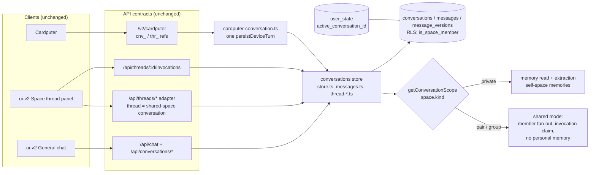
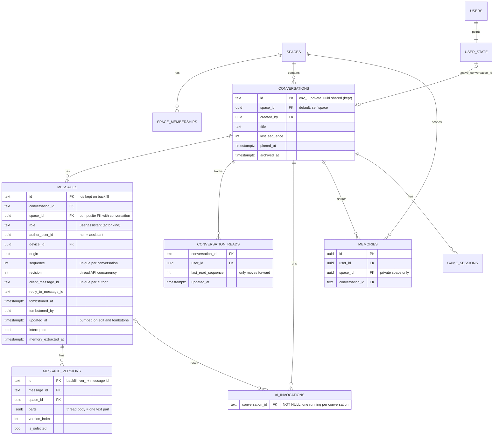
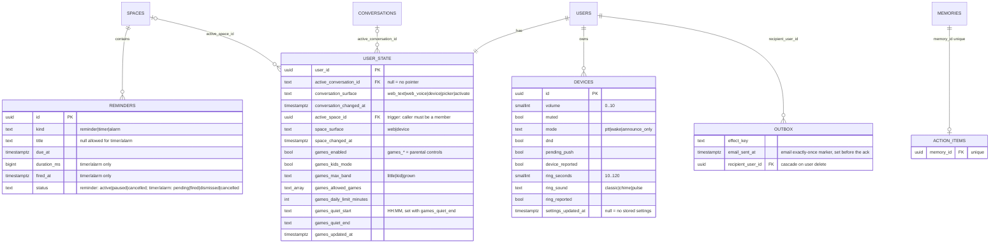
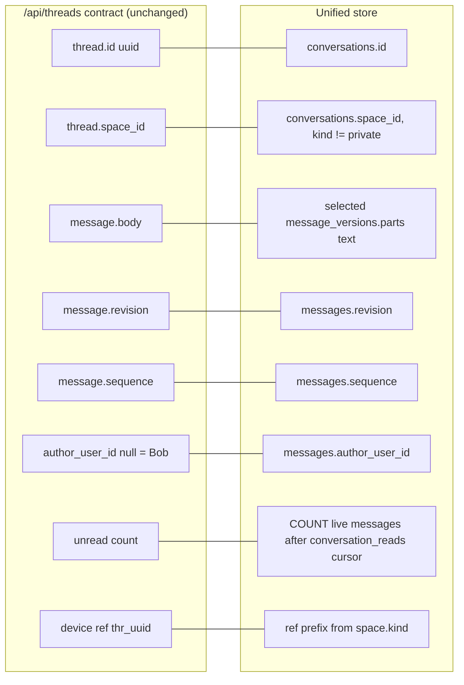
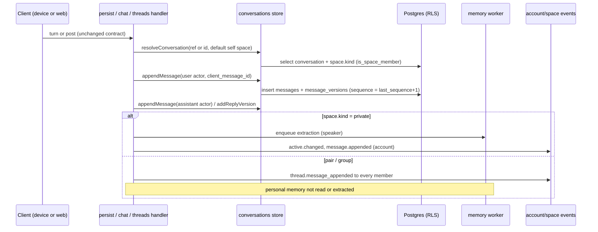
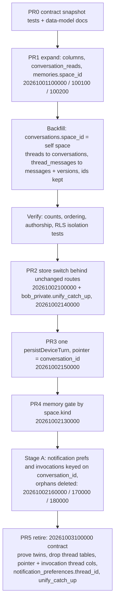
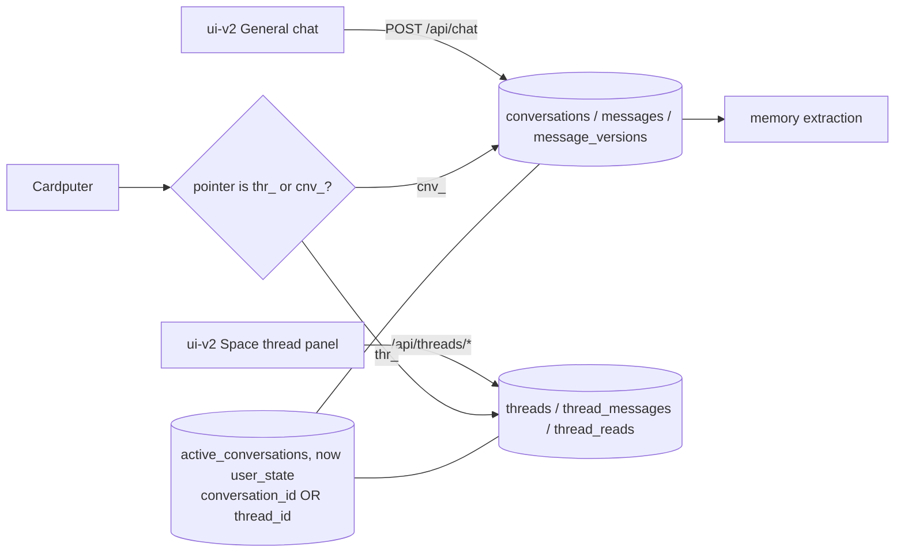

# Data model: one conversation model

Every message lives in one store: `conversations` / `messages` / `message_versions` / `conversation_reads`, scoped by space membership and `space.kind` (issue #756, a storage-only consolidation with the APIs unchanged). A thread is a conversation in a shared (pair or group) space and keeps `thread` as its API name; the private space is General. The two-store design it replaced is under [History (before #756)](#history-before-756).

## Decisions

- **No API change.** All external contracts (`/api/chat`, `/api/threads/*`, WebSocket refs `cnv_`/`thr_`) remain byte-for-byte identical (locked by snapshot tests, #761). ui-v2 and the Cardputer firmware needed no changes.
- **IDs are preserved.** Conversations and messages kept their UUIDs (`cnv_…` for General, `uuid` for threads) on backfill, so there is no mapping table. Backfilled thread versions got deterministic ids `ver_<message id>`.
- **Memory scope = space.** Existing rows were backfilled to the owner's private space. Personal memory is private-space memory: `allowsPersonalMemory(space.kind)` (`apps/api/src/memory/extract.ts`) lets only `private` (or a legacy row with no space) read or feed it; pair and group conversations skip both.
- **Drop happened last.** The thread tables (`threads`, `thread_messages`, `thread_reads`) and the legacy thread columns were dropped by the contract migration `supabase/migrations/20261003100000_conversation_unify_contract.sql` (#776), which first proves every old row has its unified twin and raises otherwise; it is applied to production with every precondition passing.

## HLD

One store with API contracts unchanged; memory and shared-mode behavior keyed by `space.kind`.

## LLD

One `conversations` table with a space key; messages and versions carry `space_id` for RLS and `author_user_id` for attribution. `space_id` stays nullable on conversations, messages, versions and memories (every product insert supplies one; the owner kept it nullable, since NOT NULL broke 83 tests and no product path needs it; tightening it is a possible later step).

Unread for a thread is a COUNT of the conversation's non-tombstoned messages with `sequence` above the caller's `last_read_sequence` (`apps/api/src/conversations/thread-rows.ts`), not `last_sequence` minus the cursor. The pointer (`user_state.active_conversation_id`) is cleared for a shared space by the definer `bob_private.clear_active_conversation_in_space`.

## Consolidated tables (#757)

Six tables were folded into their owners (expand migrations `20261003110000`..`20261003160000`; a contract migration drops the old tables). No API change.

| Old table | New home |
| --- | --- |
| `active_conversations`, `active_spaces`, `game_settings` | `bob.user_state`, one row per user |
| `device_settings` | ten columns on `bob.devices` |
| `timers` | `bob.reminders` with `kind in ('reminder','timer','alarm')` |
| `email_effects` | `bob.outbox.email_sent_at` + `recipient_user_id` |

`action_items.memory_id` is unique (`action_items_memory_id_key`): an action item is one-to-one with its memory (the planned merge of the two was dropped).

- **`user_state`:** a row appears with the first pointer or settings write. A null `games_updated_at` means no saved game settings (the `games_*` defaults stand), so a row can exist for the pointers alone. Changing `active_space_id` fires a trigger (`user_state_check_space`) that requires the caller to be a member of the new space.
- **`devices` settings:** a null `settings_updated_at` means no settings were stored, so the defaults stand. Erasure resets the ten columns on the kept, revoked device rows.
- **`reminders` kinds:** timers and alarms live in the owner's private space. Every reminder read filters `kind = 'reminder'`. Two consumers share the table: the timer scheduler (API process, `bob_private.timers_due`) reads `kind <> 'reminder'`; the reminder fanout (outbox runner, `reminder_fanout_sources`) reads `kind = 'reminder'`.
- **`outbox.email_sent_at`:** set when the email is handed to the provider, before the ack, so it is not `delivered_at`. Outbox pruning must keep rows where it is set.

## API adapter mapping

How the thread contract (unchanged) maps to the unified store.

## Device and web persistence

Turn flow for both clients after the unified store is live.

## Migration flow

Expand, backfill, switch, gate memory, retire. Each box names its migration. 

## History (before #756)

Two parallel schemas branched the device voice pipeline and duplicated persistence, edit and search logic: `conversations`/`messages`/`message_versions` for General chats and `threads`/`thread_messages`/`thread_reads` for shared spaces. `active_conversations` (since #757 the `user_state` row) held either a `conversation_id` or a `thread_id` + `thread_space_id` pair, the device turn chose its save path by the ref prefix, and threads never fed memory.

