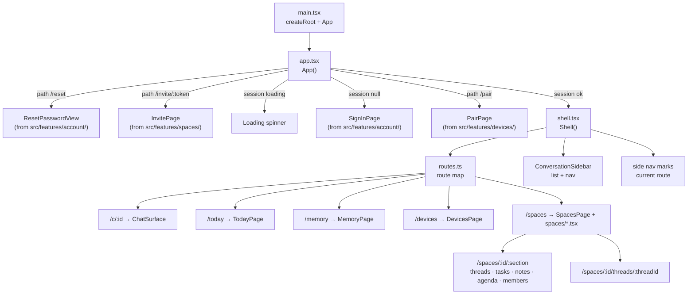
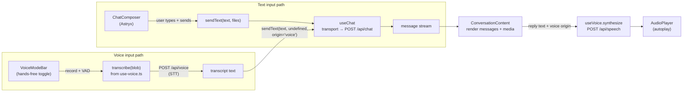

# `@bob/ui-v2` — web client

Astryx 0.6.2 React + Vite app on `apps/ui-v2`. Entry is `src/main.tsx`, routes via `src/app/routes.ts`, auth gate in `src/app/app.tsx`, shell pages in `src/app/shell.tsx`, one folder per feature in `src/features/` (chat, voice, spaces, productivity, memory, devices, account, notifications), nested nav rail in `src/features/spaces/spaces-nav.tsx`, shared code in `src/lib/`.

## Entry and routing

Routes are parsed from `window.location.pathname`. The sidebar marks the active destination. Entry pages (`/reset`, `/invite/:token`, `/pair`, sign-in) render outside the shell; `/c/:id`, `/today`, `/memory`, `/devices`, `/spaces` (with its `/spaces/:id/:section` and `/spaces/:id/threads/:threadId` sub-routes) render inside it with the sidebar.

## Shell and Spaces

The shell frame (`Shell()` in `src/app/shell.tsx`) wraps a pages map keyed by route. Spaces (`SpacesPage` in `src/features/spaces/spaces-page.tsx`) mounts five panels from `src/features/spaces/` (threads, members) and `src/features/productivity/` (agenda, tasks, notes), switched by the route's section and navigated via the nested rail (`src/features/spaces/spaces-nav.tsx`):

- `thread-panel.tsx` — chat threads with members
- `agenda-panel.tsx` — calendar events for the space
- `tasks-panel.tsx` — task list with filters
- `notes-panel.tsx` — searchable notes
- `members-panel.tsx` — space members and permissions

Each panel imports its data-fetching and local-state hooks from its own feature folder.

## Data layer

Shared code is in `src/lib/`; each feature keeps its own API client and hooks beside its components in `src/features/<name>/`:

- **`auth/`** — session state and Supabase setup
  - `use-session.ts` — load session, detect sign-in paths (OTP, password, dev loopback)
  - `supabase-client.ts` — client init with JWT bearer headers
- **`use-account-events.ts`, `use-online.ts`, `use-refresh-on-focus.ts`** — shared hooks
- **`features/productivity/`** — `use-today.ts`, `use-tasks.ts` and the other task, agenda, event and note hooks
- **`features/chat/`** — `use-conversation-list.ts`, `use-conversations.ts`, composer and message view
- **`features/voice/`** — `use-voice.ts`, `use-chat-voice.ts` and `mode/` (speech input and playback)
  - `mode/vad.ts`, `mode/endpointing.ts`, `mode/playback-queue.ts` — local VAD, sentence-end detection, playback queue

Imports in components: `import { useSession } from '@/lib/auth/use-session'`; `import { useToday } from '@/features/productivity/use-today'`.

## Chat surface — text and voice

**Text:** `ChatComposer` → `sendText()` → `useChat` (AI SDK) → `/api/chat` stream → `ConversationContent` renders.

**Voice:** User presses mic button → `VoiceModeBar` starts `MediaRecorder` + VAD (hand-free end-point detection) → `transcribe(blob)` calls `/api/voice` (STT) → result becomes a text turn via `sendText(..., origin='voice')` → `/api/chat` → reply render → if reply has voice origin, `useVoice.synthesize` calls `/api/speech` for TTS, `AudioPlayer` auto-plays.

Live updates come from `useAccountEvents` (SSE `GET /api/events`, ids-only): message-appended / conversation-updated / conversation-deleted trigger refetches.
