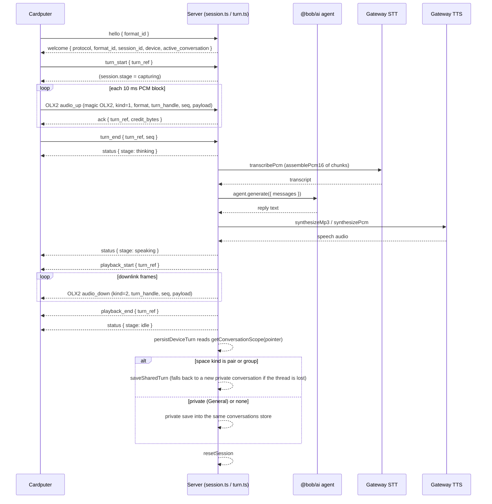
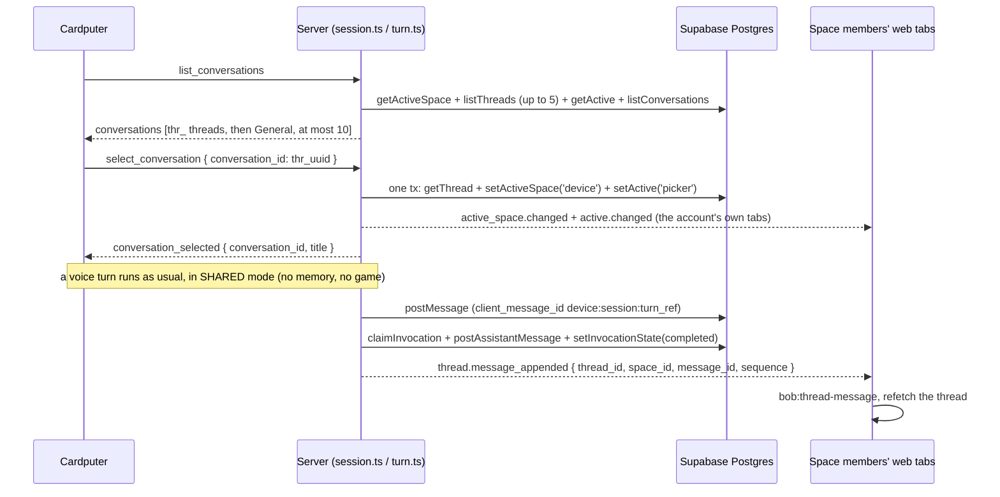
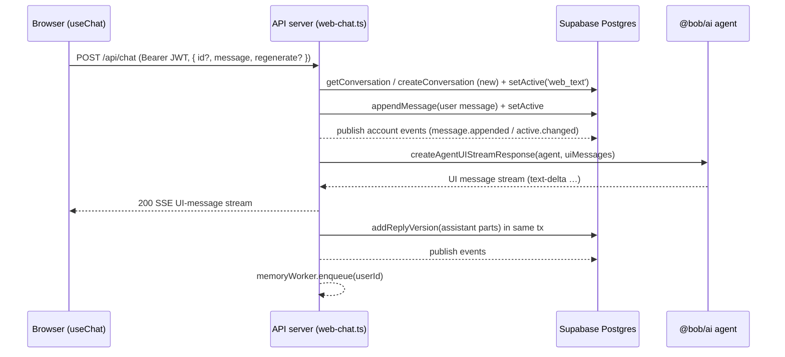
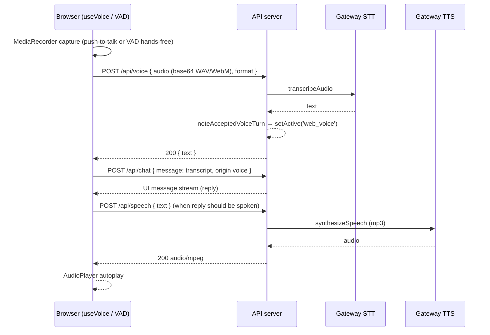
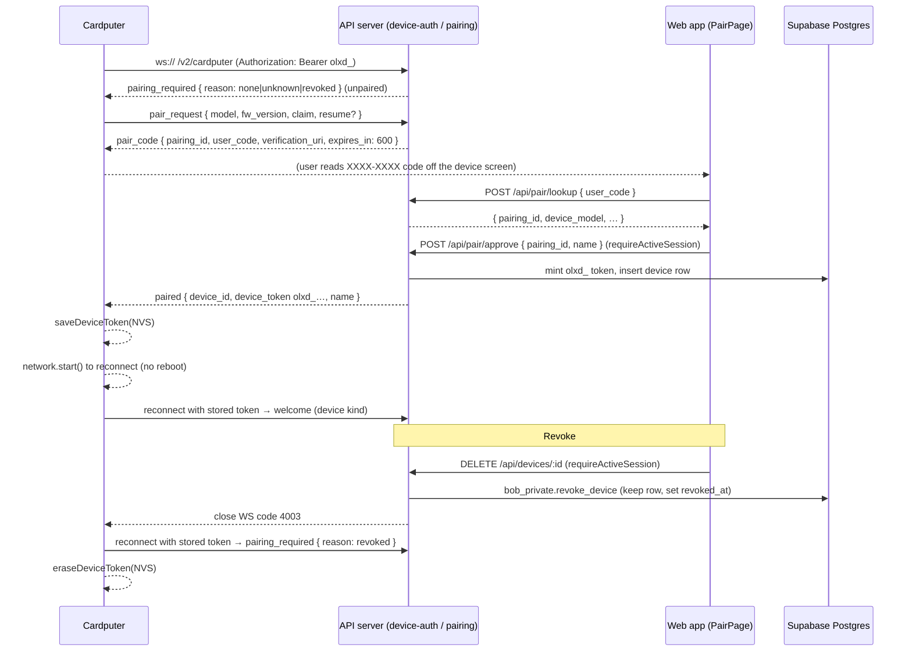
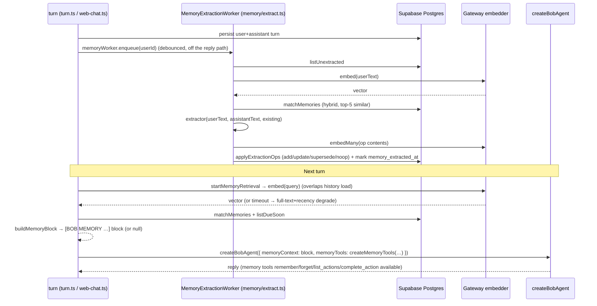
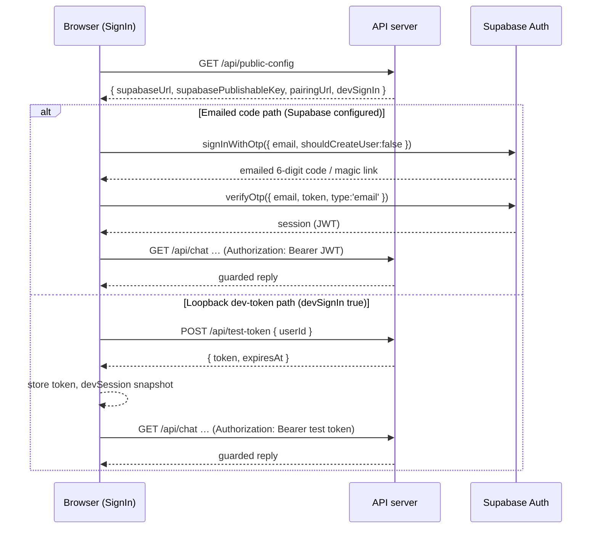

# Workflow sequence diagrams

Sequence diagrams for the flows that matter. Each is a separate diagram. Names
and messages are the real wire/event names from the code (`schemas.ts`,
`turn.ts`, `web-chat.ts`, `web-voice.ts`, `session.ts`, `pairing.ts`,
`state.cpp`).

## Device voice turn (OLX2 over WebSocket)

A push-to-talk turn. The device is already paired and welcomed.

## Device thread pointer (#565)

The device points at a space thread from its picker or from the web. The wire is unchanged: the
thread travels as the conversation id `thr_<uuid>`. Since #756 a thread is a conversation in a pair or
group space and `bob.user_state` stores only its id (`active_conversation_id`); the shared behaviour
below keys off that conversation's space kind, not the `thr_` prefix.

From the web, `PUT /api/devices/active-conversation { conversation_id: null, space_id, thread_id }`
makes the same two writes in one transaction. Archiving the space, leaving it, being removed, or
moving the active space elsewhere clears the thread pointer and publishes `active.changed` with
both fields null.

## Web text turn through `/api/chat` (with persistence)

- A new conversation derives its title from the opening text (`deriveTitle`),
  writes the follow-me pointer in the **same transaction**, and returns
  `conversationId`/`title` via message metadata.
- Regenerate / edit-from resend reuse ids to avoid duplicated replies;
  `truncateAfterMessage` handles edits.

## Web voice turn

## Device pairing

## Cross-session memory

Extraction after a turn, then retrieval + `[BOB MEMORY]` injection on a
later turn.

The memory block is a **system** section (never a user message), sanitized and
delimited; retrieval failures/timeouts omit the block rather than fail or
delay the turn.

Both halves run only in a private space (#756): the web chat and the device turn read the
conversation's `getConversationScope` and skip retrieval and enqueueing unless
`allowsPersonalMemory(spaceKind)`. The worker checks again: `listUnextracted` selects private
conversations only, and a turn from a pair or group space is marked done with no ops and journaled
`v2.memory_skipped { reason: shared_space }`.

## Sign-in

`devSignIn` is `true` only when the server binds a loopback host with
`BOB_SYSTEM_TEST=1`; `POST /api/test-token` answers 404 otherwise.