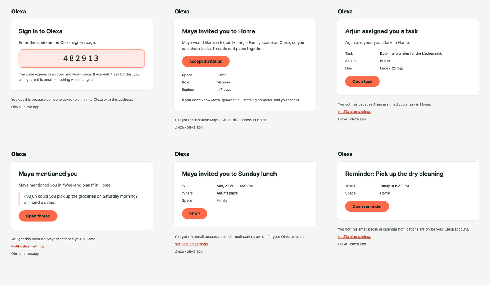

# Email catalog

Every email Bob sends, what makes it go out, and who sends it. All of them
are rendered by the one email design system in
`supabase/functions/_shared/email/` and deployed with the edge functions
(`docs/deploy.md`).

Regenerate the full gallery with
`deno run --allow-read --allow-write supabase/functions/_shared/email/preview.ts`.

Senders:

- **hook** — the `send-email` function, called by Supabase Auth through the
  Send Email Hook.
- **waitlist fn** — the `waitlist` function.
- **notify-email via outbox** — the API writes an `email.notification` outbox
  row with the in-app notification; the outbox worker calls `notify-email`.
- **notify-email direct** — the API calls `notify-email` in the request,
  best-effort, because the data must not be persisted or the recipient is
  losing access.

"State before" is the audit taken before the email wave that introduced this
catalog.

| Action | Email | Recipient | Sent by | State before | State after |
| --- | --- | --- | --- | --- | --- |
| Signs in with email | `auth-sign-in-code` | the person signing in | hook | SENT, but by Supabase's stock templates (the recipient receives the stock "Your sign-in link" email with a link, while the form asks for a code); the branded hook exists in the repo but is not enabled and templates were never pushed | Sent, code only, branded |
| Asks for a password reset | `auth-password-reset` | the account holder | hook | SENT, but by Supabase's stock templates; the branded hook is not enabled and templates were never pushed | Sent, branded |
| Admin invites a new account | `auth-account-invite` | the invitee | hook | SENT, but by Supabase's stock templates; the branded hook is not enabled and templates were never pushed | Sent, branded |
| Signs up | `auth-signup-confirm` | the new user | hook | NOT USED (signups off, no email-change UI) | Declared; unused while signups are off |
| Changes email address | `auth-email-change-current`, `auth-email-change-new` | old and new address | hook | NOT USED (signups off, no email-change UI) | Declared; unused until an email-change UI exists |
| Reauthenticates | `auth-reauthenticate` | the account holder | hook | NOT USED (signups off, no email-change UI) | Declared |
| Password / email / phone changed | `security-password-changed`, `security-email-changed`, `security-phone-changed` | the account holder | hook | NOT SENT (commented out in config.toml) | Sent |
| Identity linked / unlinked | `security-identity-linked`, `security-identity-unlinked` | the account holder | hook | NOT SENT (commented out in config.toml) | Sent |
| MFA factor enrolled / removed | `security-mfa-enrolled`, `security-mfa-unenrolled` | the account holder | hook | NOT SENT (commented out in config.toml) | Sent |
| Joins the waitlist (code) | `waitlist-code` | the person joining | waitlist fn | SENT by the waitlist function (landing-page look) | Sent, branded |
| Confirms the waitlist | `waitlist-joined` | the person joining | waitlist fn | NOT SENT | Sent |
| Invites someone to a space | `space-invite` | the invitee | notify-email direct | NOT SENT — the API returns a one-time token and the Members panel shows a link to copy by hand; an invitee with no account cannot sign up at all (signups are off) | Sent, after the `invite-account` function creates a confirmed account for an address that has none (signups stay off); the email says to open the link and sign in with this address using the six-digit code |
| Accepts a space invitation | `space-invite-accepted` | the inviter | notify-email via outbox | NOT SENT, no inbox item | Sent |
| Removes a member | `space-member-removed` | the removed member | notify-email direct | NOT SENT, no inbox item | Sent |
| Transfers ownership | `space-ownership-transferred` | the new owner | notify-email direct | NOT SENT, no inbox item | Sent |
| Archives a space | `space-archived` | every other member | notify-email direct | NOT SENT, no inbox item | Sent |
| Assigns a task | `task-assigned` | the assignee | notify-email via outbox | in-app inbox row only; NO email (outbox worker has zero handlers) | Sent |
| @mentions someone in a thread | `thread-mention` | the mentioned member | notify-email via outbox | in-app inbox row only; NO email (outbox worker has zero handlers) | Sent |
| A reminder falls due | `reminder-due` | the reminder's owner | notify-email via outbox | NOT DELIVERED anywhere (no fanout runs dueOccurrences) | Sent |
| Bob leaves a personal note | `bob-message` | the note owner | notify-email via outbox | NOT SENT (no Bob-message email template) | Sent, Bob-branded; respects notification preferences |
| Invites someone to an event | `event-invited` | the attendee | notify-email via outbox | NOT SENT (event_change type exists, no producer) | Sent |
| Updates an event | `event-updated` | the attendees | notify-email via outbox | NOT SENT (event_change type exists, no producer) | Sent |
| Cancels an event | `event-cancelled` | the attendees | notify-email direct | NOT SENT (event_change type exists, no producer) | Sent |
| Answers an event invite | `event-rsvp` | the organizer | notify-email via outbox | NOT SENT (event_change type exists, no producer) | Sent |
| Deletes the account | `account-deleted` | the account's address | notify-email direct | NOT SENT | Sent |
| Links / unlinks a Google account | `google-account-linked`, `google-account-unlinked` | the account holder | notify-email via outbox | NOT SENT | Sent |
| Pairs / removes a device | `device-paired`, `device-removed` | the account holder | notify-email via outbox | NOT SENT | Sent |

## How to add an email

Follow `supabase/functions/_shared/email/README.md`: declare the template in
the matching `templates/*.ts` module with its trigger, required fields and
sample data, send it from the right place (the hook, the waitlist function, or
the API through `notify-email`), and add its row to the table above.
